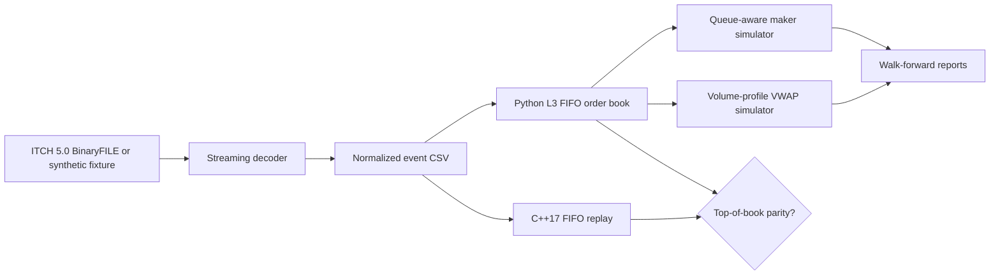

# Limit Order Book & Execution Simulator

**NASDAQ TotalView-ITCH 5.0 parsing · level-3 order-book reconstruction · counterfactual execution · Python/C++ parity**

> **Research/educational project, not an exchange emulator or live trading system.**
> All included market data are **synthetic**. Historical data, live order-routing,
> the alleged 12-million-message dataset, and the 6× résumé benchmark are **not** included or claimed.

A testable, end-to-end sandbox for understanding *what the exchange order book
actually said*, *where a hypothetical order would sit in the queue*, and *how
execution assumptions affect measured results*. Core Python tools use only the
standard library; a self-contained C++17 engine provides an independently
implemented replay for correctness and performance comparison.

## Features

| Layer | Implemented |
| --- | --- |
| Market-data ingestion | Streaming `.itch` / `.itch.gz` BinaryFILE parser; A/F/E/C/X/D/U messages; selected-symbol filtering; CSV normalization |
| Book | Per-order FIFO at each price; partial fills, cancel/delete/replace; best bid/ask, midpoint, level sizes, consistency checks |
| Strategy simulation | Passive maker quotes, latency, queue-ahead IDs, inventory limits, maker fees; out-of-sample volume-profile VWAP schedule with taker fees |
| Evaluation | Mark-to-market P&L, quote fill rate, realized spread, adverse selection, VWAP slippage, chronological holdouts |
| Acceleration | C++17 independent FIFO replay; top-of-book + live-order parity checks against Python; on-demand benchmark |
| Reproducibility | Deterministic synthetic ITCH and CSV generator, `pytest` suite, CI workflow, reproducible CLI |

## 60-second quick start

Python 3.10+; a C++17 compiler (`g++`) and `make` for the optional C++ binary.

```bash
# Unzip or clone repo, then cd into it
python -m pip install -e '.[dev]'

# Already included: sample/demo.csv and sample/demo.itch.gz
lob-sim replay --input sample/demo.csv
lob-sim parse --input sample/demo.itch.gz --symbol DEMO --output sample/reparsed.csv
lob-sim backtest --input sample/demo.csv --strategy maker --output sample/maker_results.json
lob-sim backtest --input sample/demo.csv --strategy vwap --output sample/vwap_results.json

pytest -q
make cpp
lob-sim benchmark --input sample/demo.csv --cpp-bin build/itch_replay --repeats 5
```

No private market-data credentials or API keys are required. You can always
regenerate the **synthetic** fixtures:

```bash
lob-sim demo --out-dir sample --events 5000 --seed 7
```

**No-install fallback:** From the repository root, use
`PYTHONPATH=src python -m lob_sim replay --input sample/demo.csv`
(on Windows PowerShell: `$env:PYTHONPATH="src"; python -m lob_sim ...`).

## System design



The internal event schema is a simple, documented CSV:

```text
ts_ns,kind,order_id,side,shares,price_ticks,new_order_id,symbol,trade_price_ticks
```

All prices are integer **1/10,000 USD** (for example `1000100` = `$100.01`).
All timestamps are **nanoseconds since exchange midnight**, without any
assumed UTC conversion. `E` and `C` are execution messages; `U` changes the
order reference and resets its FIFO priority. Only A/F messages carry the
symbol on the wire; the selected-symbol parser tracks modifications by order
reference.

## Examples

### 1. Reconstruct and sanity-check the book

```bash
lob-sim replay --input sample/demo.csv --check-every 500 --depth 5
```

Outputs level quantities on both sides, total events, displayed live orders,
and executed share counts. Internal invariants reject duplicate IDs,
over-reductions, empty levels, and inconsistent queues.

### 2. Simulate passive market making

```bash
lob-sim backtest --input sample/demo.csv --strategy maker \
  --clip 30 --max-inventory 150 --latency-ms 3 --refresh-ms 200 \
  --folds 3 --output sample/maker_results.json
```

A quote joins **behind existing identified resting orders** at its displayed
price. Execution/cancellation of those identified ahead orders removes queue
priority. Only observed executions of later orders at the same price can
produce a hypothetical fill after the original queue ahead clears. This
prevents a simplistic assumption that *any* volume at the best price would
necessarily have hit our limit order.

Every refresh goes live no earlier than the timestamp plus the modeled
latency, rounded conservatively to the next feed event. Quotes remain live
until replacement. Inventory is bounded, and per-share maker fees/rebates
contribute to P&L. Realized spread uses a 250ms future midpoint if available.

### 3. Simulate volume-profile VWAP execution

```bash
lob-sim backtest --input sample/demo.csv --strategy vwap \
  --side B --target 250 --folds 3 --output sample/vwap_results.json
```

Estimate time-bucket volume weights from the **past training window only**.
In the next, disjoint holdout block, use those weights to schedule marketable
child slices, swept against displayed snapshot liquidity. Report execution
VWAP and slippage against the observed print VWAP.

**Limitations:** The marketable fills are optimistic (zero market impact and no
routing constraints), and a normalized within-window volume profile is not a
true multi-day time-of-day forecast. A credible extension would train on
previous trading days and compare VWAP, TWAP, and POV under shared risk limits.

### 4. Benchmark Python against C++

```bash
make cpp
lob-sim benchmark --input sample/demo.csv --cpp-bin build/itch_replay --repeats 5
```

The benchmark first compares **identical top five bids/asks, quantities,
message counts, and live order counts**. If any comparison fails, it raises an
error rather than reporting a speedup. Otherwise it prints *measured*
median wall-time for both replayers. Numbers will vary substantially by
CPU, compiler, dataset size, cache state, and whether process startup dominates.

This benchmark compares **normalized CSV replay**; it does *not* benchmark
ITCH decoding, does *not* assert a 6× speedup, and does *not* establish
throughput on 12 million messages.

A sample smoke-test report with clearly labeled synthetic metrics is in
[`docs/EXAMPLE_RESULTS.md`](docs/EXAMPLE_RESULTS.md).

## Using real ITCH market data

1. Obtain legitimately licensed/accessed **NASDAQ TotalView-ITCH 5.0 historical
   BinaryFILE** records. They are not distributed with this repo.
2. Begin at the start of the daily feed; modifications reference earlier adds.
3. Parse one symbol to a normalized CSV with `lob-sim parse`.
4. Reconstruct and verify the data before analyzing backtests.
5. Use **different historical days** to fit volume schedules and assess
   out-of-sample results; do not treat the synthetic demo as evidence.

```bash
lob-sim parse --input /path/to/SMMDDYY-v50.txt.gz \
  --symbol AAPL --output /path/to/aapl_events.csv
lob-sim replay --input /path/to/aapl_events.csv
```

Official format reference: [NASDAQ TotalView-ITCH 5.0 specification](https://www.nasdaqtrader.com/content/technicalsupport/specifications/dataproducts/NQTVITCHSpecification.pdf)
([historical-data FAQ](https://www.nasdaqtrader.com/Content/TechnicalSupport/FAQs/ITCH_FAQ.pdf)).

The parser intentionally skips non-book-changing message types, including
trades that aren't resting orders, auction crosses, and various status
messages; it is **not** a full exchange-event implementation. See
[`docs/MODEL_ASSUMPTIONS.md`](docs/MODEL_ASSUMPTIONS.md) for explicit caveats.

## Publishing to GitHub

After downloading and unzipping, create a new GitHub repository with the same
name (or use the GitHub CLI after logging in):

```bash
git init -b main
git add .
git commit -m "Implement ITCH order book replay and execution backtests"
gh repo create lob-execution-simulator --public --source=. --remote=origin --push
```

If you prefer the GitHub website, create an empty repo there, then run
`git remote add origin YOUR_GITHUB_REPO_URL` and
`git push -u origin main` (ensure your default branch is `main`).

## Tests and repo structure

```text
lob-execution-simulator/
├── .github/workflows/tests.yml    # CI on push and pull request
├── cpp/itch_replay.cpp             # Independent C++17 FIFO replay
├── docs/MODEL_ASSUMPTIONS.md       # Execution assumptions and caveats
├── sample/demo.csv                # Synthetic normalized feed (committed)
├── sample/demo.itch.gz            # Synthetic ITCH binary (committed)
├── src/lob_sim/
│   ├── book.py                    # Order IDs, FIFO levels, invariants
│   ├── events.py                  # Strongly typed normalized messages
│   ├── itch.py                    # Streaming BinaryFILE ITCH subset
│   ├── synthetic.py               # Seeded reproducible generator
│   ├── io.py                      # CSV serialization and validation
│   ├── sim.py                     # Queue-aware maker, VWAP, walk forward
│   └── cli.py                     # demo / parse / replay / backtest / benchmark
├── tests/                          # Parser, queue, fill, VWAP, C++ parity
├── Makefile
├── pyproject.toml
└── LICENSE
```

### Suggested next research milestones

- Benchmark 1M+ **licensed** ITCH messages, with throughput and memory charts;
  report full-book parity, not only top-of-book.
- Index/aggregate live orders by price in C++ for faster depth queries, and
  support sampled L2 snapshot checkpoints.
- Add order-hold-time and risk-based quote cancellations, then compare realized
  spread and adverse selection by liquidity regime.
- Build a multi-day VWAP volume curve, with separate training/validation/test
  days and realistic execution participation caps.
- Model market impact, hidden liquidity, queue cancellations, fees, exchange
  halts, and stale-price fill uncertainty.

## License

MIT. Educational simulation; not financial advice or a claim of historical
trading results.
